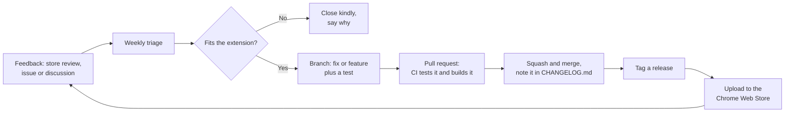

# Maintaining Neat Tab Sorter

A playbook for running the project: where feedback arrives, how to triage it, how to review pull requests, and how to ship releases.

## Where things live

| What | Where |
| --- | --- |
| Code, issues, pull requests and releases | [GitHub](https://github.com/francarraras/neat-tab-sorter) |
| Questions and loose ideas | [GitHub Discussions](https://github.com/francarraras/neat-tab-sorter/discussions) |
| Security reports | The repository's **Security** tab (private) |
| Store listing, reviews, install numbers and publishing | [Chrome Web Store developer dashboard](https://chrome.google.com/webstore/devconsole) |
| Plans | Issues, grouped with milestones such as "1.1.0" |

## The loop



## Weekly triage (about 15 minutes)

- New issues arrive labeled `needs triage`. For each one: reproduce it, label it (`bug`, `enhancement`, `question`...), and remove `needs triage`.
- If details are missing, ask for them. The bug form already asks for the version, browser and sort order.
- Close duplicates with a link to the original.
- Label small, well-defined tasks `good first issue` so newcomers can find them.
- In the store dashboard, reply to reviews and support messages, and turn real problems into issues.
- Before saying yes to a feature, check it fits: it sorts tabs (rather than managing them), stays fast, and keeps everything on the user's computer. A clear, kind "no, and here's why" is fine.

## Reviewing a pull request

1. CI must be green: unit tests and browser tests.
2. Try it: in the run's summary, download **neat-tab-sorter-build**, unzip it, and **Load unpacked**.
3. Check it keeps the promises: no new permissions without a strong reason, and no network requests, analytics or remote code.
4. Use **Squash and merge** with a clear title, so each change is one commit in the history.
5. With Claude Code: `gh pr checkout <number>`, then run `/code-review`.

## Releasing

Versions follow [semantic versioning](https://semver.org): 1.0.1 for fixes, 1.1.0 for new features, 2.0.0 for big changes in behavior.

1. In `CHANGELOG.md`, move the "Unreleased" notes under a new heading, like `## [1.1.0] - 2026-11-02`.
2. Set the same version in `src/manifest.json`.
3. Commit, tag, and push:

   ```sh
   git commit -am "Release 1.1.0"
   git tag v1.1.0
   git push origin master v1.1.0
   ```

4. The release workflow runs every test, builds `neat-tab-sorter-v1.1.0.zip`, and publishes a GitHub release with it, using the changelog section as release notes.
5. Upload that zip in the store dashboard (**Package**, then **Upload new package**) and submit it for review. [PUBLISHING.md](PUBLISHING.md) covers the first submission.

## Keeping things fresh

- **Dependencies:** Dependabot opens monthly pull requests for Playwright, Remotion and the GitHub Actions. Merge them when CI passes. The extension itself has no dependencies.
- **The original project:** the `upstream` remote points to [pwhite2/simple-tab-sorter](https://github.com/pwhite2/simple-tab-sorter). Now and then, run `git fetch upstream` and cherry-pick any fixes worth bringing over.
- **Chrome changes:** new tab features (like split view) can change how moves behave. The browser tests run on the latest Chromium every time CI runs, and Dependabot's Playwright updates bring newer Chromium versions.
