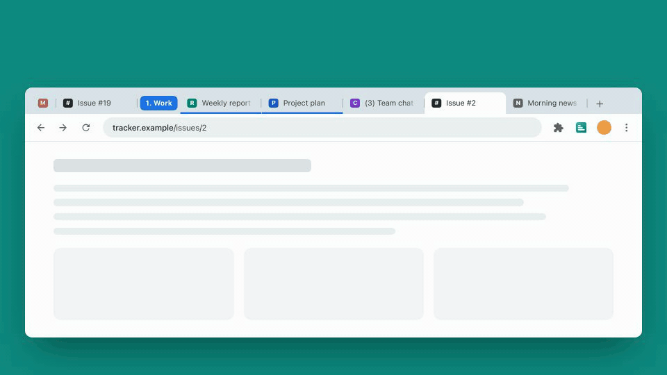
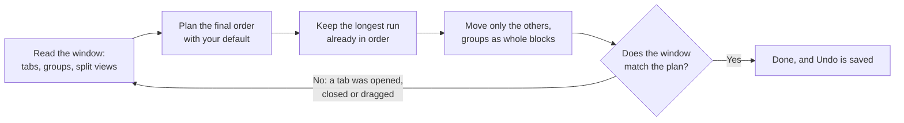
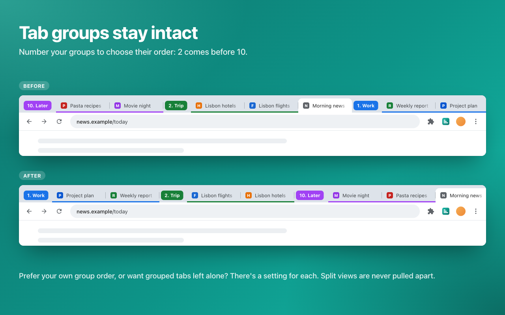
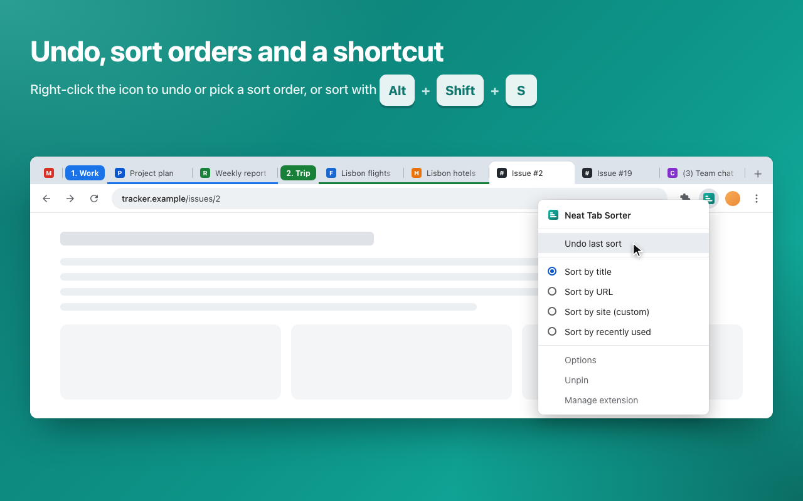
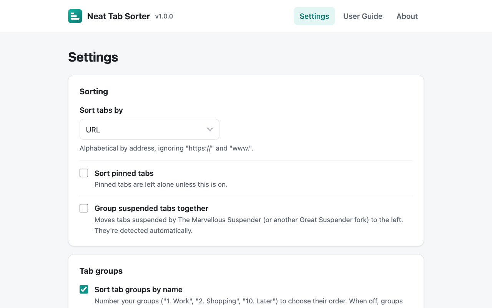
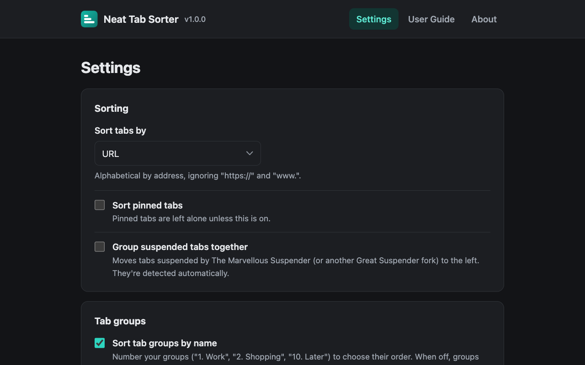

# Neat Tab Sorter

**Your tabs, in your order, in one click. Fast, exact, and undoable.**

## Why you'll like it

- **Your order, as the default.** Sort by title, URL, site or recent use. Pick one from the toolbar icon's right-click menu and every click and shortcut uses it from then on, synced across your computers.
- **Fast.** It plans the whole window first, then moves only the tabs that are out of place. On a laptop, 150 shuffled tabs sort in about a tenth of a second, and sorting a window that's already sorted doesn't move a thing.
- **Exact.** It never misses: tab groups stay intact, split views stay together, pinned tabs stay put, and "Issue #2" comes before "Issue #19". If you open, close or drag a tab mid-sort, it notices and finishes the job. And **Undo** puts every tab back exactly where it was.

## Sort orders

| Order | How tabs are arranged | Handy for |
| --- | --- | --- |
| **Title** | A to Z by page title. Unread counters like "(3) Inbox" are ignored. | Finding a page by name |
| **URL** | By address, ignoring `https://` and `www.` | Keeping each site's pages together |
| **Custom (by site)** | Each site's tabs together, sites in the order they already appear | Your own site order: drag a site's first tab, then sort |
| **Recently used** | Most recently used first | Getting back to what you were doing |

Every order compares numbers naturally and ignores upper and lower case. Tab groups always stay intact and come first, ordered by name (number them to choose: "1. Work", "2. Trip", "10. Later"), or in your own order if you prefer.

| To... | Do this |
| --- | --- |
| Sort the current window | Click the toolbar icon, or press <kbd>Alt</kbd>+<kbd>Shift</kbd>+<kbd>S</kbd> |
| Undo the last sort | Right-click the icon, then **Undo last sort** (or give it a shortcut) |
| Change your default order | Right-click the icon and pick an order (it sorts right away), or open the settings |
| Change the shortcuts | Go to `chrome://extensions/shortcuts` |

## How it never misses

Every test run replays thousands of random windows, with pinned tabs, tab groups and split views, against a model of Chrome's own tab-moving rules. It checks that no tab lands in the wrong group, no split view breaks, sorting twice changes nothing, and Undo restores the exact order. Then the real extension is tested in Chromium.

## Screenshots

<table>
  <tr>
    <td></td>
    <td></td>
  </tr>
  <tr>
    <td></td>
    <td></td>
  </tr>
</table>

## Install

- **Chrome Web Store:** coming soon.
- **From source:** download or clone this repository, open `chrome://extensions`, turn on **Developer mode**, click **Load unpacked** and choose the `src` folder.

It works in Chrome and in other Chromium browsers, such as Edge and Brave. The User Guide, linked from the settings page, explains every option.

## Privacy

No data collection, no network requests, no ads and no remote code. Tabs are read only to sort them, on your computer. See the [privacy policy](PRIVACY.md).

## Contributing

Bug reports, ideas and pull requests are welcome. [CONTRIBUTING.md](CONTRIBUTING.md) explains how the project is organized and how to run it; `npm test` needs nothing but Node.js 22.

## Credits and license

Neat Tab Sorter is based on [Simple Tab Sorter](https://github.com/pwhite2/simple-tab-sorter) by Peter White and was modified from it in 2026. Both are free software under the [GNU General Public License v3](LICENSE).
